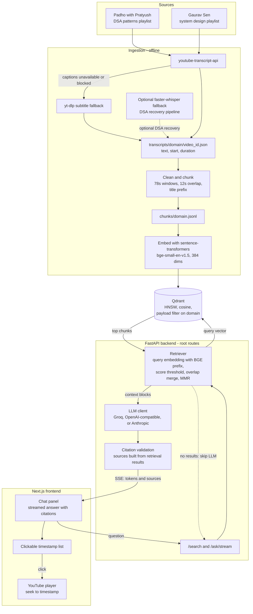
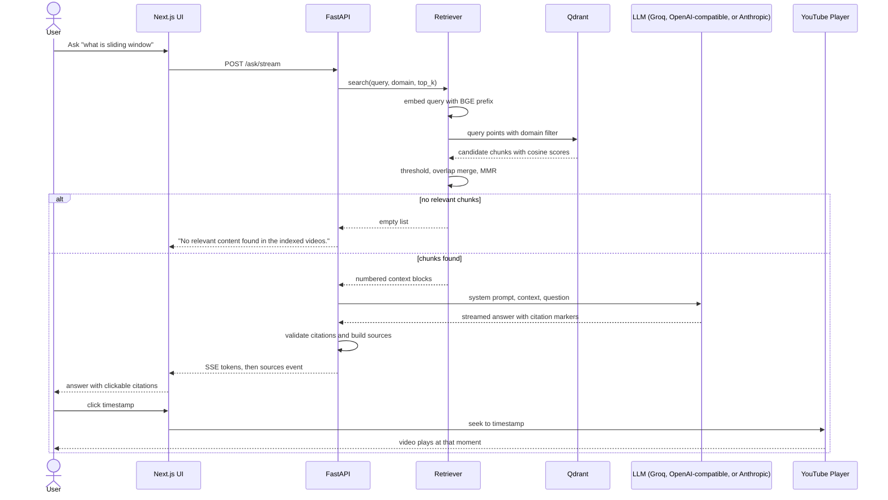
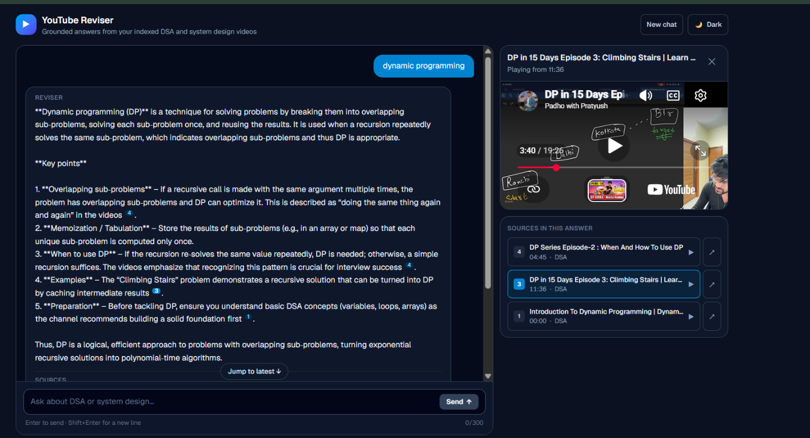
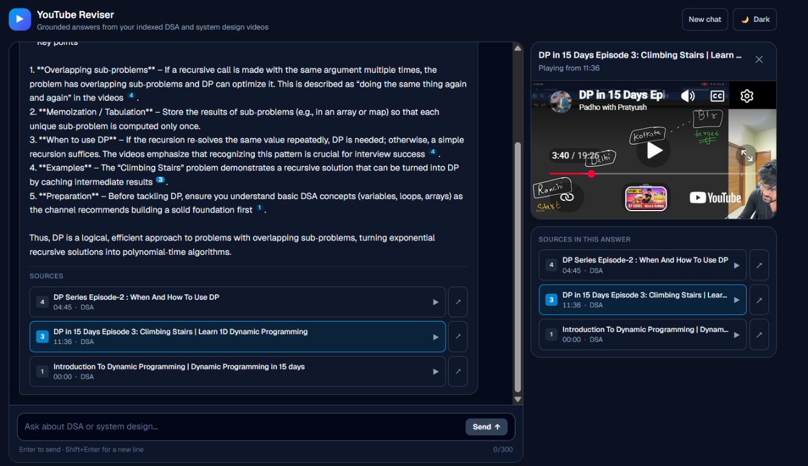
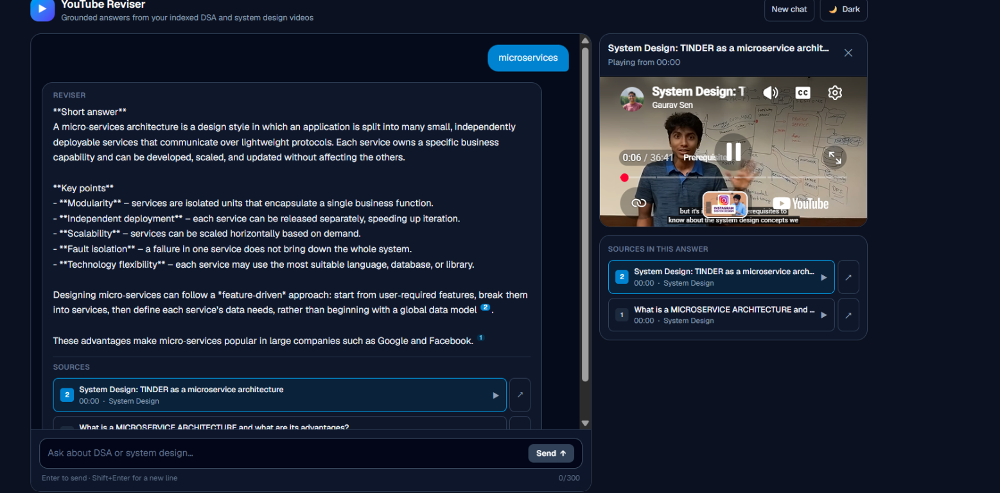
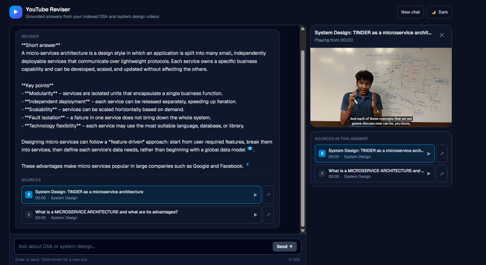

# YouTube Reviser

A retrieval-augmented revision tool for placement preparation: ask about DSA or system design and get an answer grounded in indexed YouTube captions, with cited sources and timestamps that open at the relevant moment.

[](https://www.python.org/)
[](https://fastapi.tiangolo.com/)
[](https://qdrant.tech/)
[](https://nextjs.org/)

> **Screenshot TODO:** Add a screenshot or GIF showing a cited answer, a clicked timestamp, and the embedded player.

**Stack:** Python | FastAPI | yt-dlp | youtube-transcript-api 1.x | sentence-transformers (`BAAI/bge-small-en-v1.5`) | Qdrant | Next.js | TypeScript | Tailwind CSS.

**Quick start:** Python 3.11+, Node.js 20.9+, and Docker are required. From the repository root, install dependencies, configure `.env`, start Qdrant, and build the local index:

```powershell
py -3.11 -m venv .venv
.\.venv\Scripts\Activate.ps1
pip install -r requirements.txt
if (-not (Test-Path .env)) { Copy-Item .env.example .env }
docker compose up -d qdrant
python scripts/download_transcripts.py --domain all
python scripts/chunk_transcripts.py --domain all
python scripts/embed_and_store.py --domain all
```

Then start the API with `uvicorn app.main:app --reload --port 8000`; full Windows/Bash setup and frontend steps are in [Quick start](#5-quick-start).

## 2. Features

- Answers questions using indexed captions from [Padho with Pratyush](https://www.youtube.com/playlist?list=PLbJhGqY-mq47k_WLUtzVjmarUm1EuXPj2) DSA and Gaurav Sen system-design videos.
- Answers are prompted to stay under 250 words unless more detail is requested.
- Valid citation markers link to retrieved source videos and timestamps. Source links are assembled from retrieval results in code, not invented by the LLM.
- The API accepts a `domain` filter (`dsa` or `system_design`); the web chat searches both domains.
- `/ask/stream` streams answer tokens over Server-Sent Events (SSE). The web UI displays the stream.
- Clicking a source timestamp seeks the embedded YouTube player to that time. A separate link opens the original video.
- When retrieval returns no results, the answer is `No relevant content found in the indexed videos.` and the LLM is not called. If the retrieved context is insufficient, the model is instructed to say `I couldn't find this in the indexed videos.`

## 3. How it works

```text
Playlists
   |
   v
download_transcripts.py --> transcripts/<domain>/*.json
   |
   v
chunk_transcripts.py -----> chunks/*.jsonl
   |
   v
embed_and_store.py -------> sentence-transformers --> Qdrant
                                                       |
Question --> query embedding --> retrieve.py ----------+
                                                       |
                                                       v
                                         generate.py --> FastAPI --> Next.js UI
```

- **Dense retrieval:** document embeddings are normalized; queries use the BGE search prefix. Qdrant cosine search applies a score threshold and MMR diversity by default; an optional cross-encoder reranker is also implemented. There is no keyword/BM25 search.
- **Overlap handling:** adjacent hits from the same video are merged when their timestamps overlap or are within 20 seconds, reducing duplicate source entries.
- **Validated citations:** the LLM receives numbered context blocks. Invalid citation numbers are removed, and source links are built from the corresponding retrieved results.
- **No-context shortcut:** empty retrieval returns a fixed not-found response without spending an LLM call.
- **Direct SDKs:** generation uses provider SDKs in `scripts/generate.py`; it does not use LangChain.

Chunk windows target 78 seconds with 12 seconds of overlap. Chunk text is prefixed with the video title for embedding. Qdrant stores 384-dimensional cosine vectors, uses HNSW, and indexes `domain`, `video_id`, and `start` payload fields.

### Architecture and data pipeline



### What happens when a user asks a question



## 4. Current coverage

Counts were verified on 2026-11-17 against the local Qdrant collection `youtube_reviser` and the `chunks/*.jsonl` files. Every locally downloaded transcript has been chunked and embedded, so the collection holds the complete local corpus for both domains.

| Domain | Source | Indexed videos | Indexed chunks |
|---|---|---:|---:|
| DSA | Padho with Pratyush — DSA Patterns | 126 | 4,108 |
| System Design | Gaurav Sen | 24 | 357 |
| **Total** | | **150** | **4,465** |

The collection contains exactly 4,465 points, split 4,108 DSA and 357 System Design, with 384-dimensional cosine vectors, HNSW indexing, and payload indexes on `domain`, `video_id`, and `start`.

The indexed corpus is complete: all 126 locally downloaded DSA videos and all 24 System Design videos are chunked and embedded. The System Design playlist itself has 26 videos; the 2 that are not indexed could not be ingested (one has captions disabled and one was skipped by the downloader). Questions answered only by those two videos return the not-found response.

## 5. Quick start

### Prerequisites

- Python 3.11 or newer (`pyproject.toml` requires `>=3.11`; `.python-version` is `3.11`).
- Node.js 20.9 or newer (the installed Next.js package declares `>=20.9.0`).
- Docker Desktop with Docker Compose, and Git.
- A Groq API key for generated answers with the default `LLM_PROVIDER=groq`. `/search` works without an LLM key.

### 1. Clone and install Python dependencies

**PowerShell**

```powershell
git clone https://github.com/kxshith21/youtube-revisor-rag.git
Set-Location youtube-revisor-rag
py -3.11 -m venv .venv
.\.venv\Scripts\Activate.ps1
pip install -r requirements.txt
if (-not (Test-Path .env)) { Copy-Item .env.example .env }
```

**Bash**

```bash
git clone https://github.com/kxshith21/youtube-revisor-rag.git
cd youtube-revisor-rag
python3.11 -m venv .venv
source .venv/bin/activate
pip install -r requirements.txt
[ -f .env ] || cp .env.example .env
```

Edit `.env` and set `GROQ_API_KEY` before using `/ask`, `/ask/stream`, `/revise`, or `/quiz`. Do not commit `.env`.

### 2. Start Qdrant and build the index

From the repository root, start the Qdrant service:

```powershell
docker compose up -d qdrant
```

Run the pipeline (caption downloads can take a long time):

```powershell
python scripts/download_transcripts.py --domain all
python scripts/chunk_transcripts.py --domain all
python scripts/embed_and_store.py --domain all
```

The embedder downloads `BAAI/bge-small-en-v1.5` on first use. Qdrant data is stored in the Compose `qdrant_storage` volume.

### 3. Run the backend

In a new terminal at the repository root, activate `.venv` and run:

```powershell
uvicorn app.main:app --reload --port 8000
```

Open <http://localhost:8000/docs> for Swagger UI. API routes are currently at the root (for example, `/search`), not under `/api/v1`.

### 4. Run the frontend

In another terminal:

```powershell
if (-not (Test-Path web\.env.local)) { Copy-Item web\.env.example web\.env.local }
Set-Location web
npm install
npm run dev
```

Open <http://localhost:3000>. For Bash, use `[ -f web/.env.local ] || cp web/.env.example web/.env.local`, then `cd web`, `npm install`, and `npm run dev`. The web app requires the backend for real answers.

## 6. Configuration

Values below are the examples/defaults in `.env.example`. Never put real API keys in this README or in `web/.env.local`.

| Variable | Example value | Purpose |
|---|---|---|
| `LLM_PROVIDER` | `groq` | Default LLM provider. The generator also has OpenAI-compatible/Ollama and Anthropic clients; optional provider packages may need separate installation. |
| `LLM_MODEL` | `openai/gpt-oss-20b` | Model name passed to the configured provider. |
| `GROQ_API_KEY` | *(blank)* | Required for the default Groq provider and generated answers. |
| `ANTHROPIC_API_KEY` | *(blank)* | Key for `LLM_PROVIDER=anthropic`. |
| `OPENAI_API_KEY` | *(blank)* | Key for `LLM_PROVIDER=openai` or an OpenAI-compatible provider; Ollama may run without one. |
| `OPENAI_BASE_URL` | *(blank)* | Optional custom endpoint, such as a local Ollama OpenAI-compatible endpoint. |
| `MAX_TOKENS` | `1000` | Maximum output tokens requested from the LLM. |
| `TEMPERATURE` | `0.2` | LLM sampling temperature. |
| `QDRANT_URL` | `http://localhost:6333` | Qdrant server URL. |
| `QDRANT_API_KEY` | *(blank)* | Optional Qdrant Cloud key; local Docker Qdrant needs none. |
| `ALLOWED_ORIGINS` | `http://localhost:3000,http://localhost:8501` | Comma-separated backend CORS origins. |
| `API_KEY` | *(blank)* | Optional API authentication key. `/health` remains public. |
| `RATE_LIMIT_SEARCH` | `30` | Search requests per minute, per IP. |
| `RATE_LIMIT_ASK` | `10` | Ask/revise/quiz requests per minute, per IP. |
| `LOG_LEVEL` | `INFO` | Backend log level. |
| `ASK_TIMEOUT_S` | `30` | Timeout for ask, revise, and quiz requests. |
| `STREAM_TIMEOUT_S` | `60` | Maximum SSE stream duration. |
| `STREAM_HEARTBEAT_S` | `15` | Interval between SSE heartbeat comments. |
| `CACHE_TTL_S` | `600` | In-memory cache lifetime for answers, topics, and videos. |
| `CACHE_MAX_ENTRIES` | `500` | Maximum entries per in-memory cache. |

`/search` performs retrieval only and does not require an LLM key. The current generator has Groq, OpenAI-compatible/Ollama, and Anthropic clients; Gemini is not implemented in `make_llm()`, despite `google-genai` appearing in `pyproject.toml`.

The frontend has a separate `web/.env.local`:

| Variable | Example value | Purpose |
|---|---|---|
| `NEXT_PUBLIC_API_BASE_URL` | `http://localhost:8000` | FastAPI base URL. |
| `NEXT_PUBLIC_MOCK` | `false` | Set to `true` to show canned UI responses without the backend. |

## 7. Data pipeline

Run scripts from the repository root. `--domain` accepts `dsa`, `system_design`, or `all` where shown.

| Script | Input | Output | Example |
|---|---|---|---|
| `scripts/download_transcripts.py` | YouTube playlist captions | `transcripts/<domain>/<video_id>.json`; failure and missing queues | `python scripts/download_transcripts.py --domain dsa --limit 5` |
| `scripts/chunk_transcripts.py` | Transcript JSON and `glossary.json` | `chunks/dsa.jsonl` and `chunks/system_design.jsonl` | `python scripts/chunk_transcripts.py --domain all` |
| `scripts/embed_and_store.py` | Chunk JSONL | Points in Qdrant collection `youtube_reviser` | `python scripts/embed_and_store.py --domain all` |
| `scripts/retrieve.py` | Query and Qdrant collection | Ranked JSON or human-readable results | `python scripts/retrieve.py "sliding window" --domain dsa --top-k 5` |
| `scripts/generate.py` | Query, retrieved context, configured LLM | Answer/revision/quiz output with validated sources | `python scripts/generate.py "sliding window" --domain dsa --stream` |

`download_transcripts.py` uses `youtube-transcript-api` and falls back to yt-dlp captions. It supports `--retry-failed`, `--dry-run`, `--limit`, `--batch-size`, `--min-delay`, `--max-delay`, `--video-id`, `--priority-file`, and `--cookies-file`.

`scripts/download_playlist_full.py` is a separate **DSA-only** recovery pipeline. It tries the transcript API, yt-dlp captions, then optional faster-whisper transcription; it supports `--limit`, `--whisper-only`, `--captions-only`, `--whisper-model`, `--whisper-language`, `--priority-file`, and `--dry-run`.

`chunk_transcripts.py` supports `--window`, `--overlap`, and `--limit`. `embed_and_store.py` supports `--limit`, `--batch-size`, `--quantize`, and `--rebuild`. Use `--rebuild` when changing the embedding model; it deletes and recreates the collection, so rebuild both domains with:

```bash
python scripts/embed_and_store.py --domain all --rebuild
```

Other scripts include `scripts/query.py` (search), `scripts/dedupe_transcripts.py` (transcript/chunk deduplication), and `scripts/download_playlist_full.py` (DSA recovery).

### Repository layout

```text
.
app/                  # FastAPI app, services, schemas, routers, settings
scripts/              # Caption, chunk, embedding, retrieval, generation tools
tests/                # Python tests; external services are mocked
web/                  # Next.js, TypeScript, Tailwind chat UI
transcripts/          # Local downloaded captions; Git-ignored
chunks/               # Generated chunk JSONL; Git-ignored
logs/                 # Downloader failure reports
glossary.json          # Caption term corrections
Dockerfile             # API image
docker-compose.yml     # Qdrant and API services
requirements.txt       # Python runtime and test dependencies
pyproject.toml         # Python project metadata/dependencies
API.md                 # Expanded API, Docker, and curl documentation
```

## 8. API reference

The current routes are not prefixed with `/api/v1`. See Swagger at <http://localhost:8000/docs> or the expanded [API reference](API.md).

| Method | Path | Purpose |
|---|---|---|
| `GET` | `/health` | Service, Qdrant, embedding, and LLM readiness. |
| `POST` | `/search` | Retrieval only; no LLM call. |
| `POST` | `/ask` | Generate a grounded answer. |
| `POST` | `/ask/stream` | Stream an answer as SSE. |
| `POST` | `/revise` | Generate a revision note. |
| `POST` | `/quiz` | Generate cited quiz questions. |
| `GET` | `/topics` | Per-domain indexed video and chunk counts. |
| `GET` | `/videos` | Paginated indexed videos; supports `domain` and title query `q`. |

Examples use Bash `curl`. If `API_KEY` is set, add `-H "X-API-Key: $API_KEY"` to protected endpoints; `/health` is public.

**Search**

```bash
curl -sS -X POST http://localhost:8000/search \
  -H "Content-Type: application/json" \
  -d '{"query":"sliding window maximum","domain":"dsa","top_k":5,"use_mmr":true,"use_reranker":false}'
```

**Ask**

```bash
curl -sS -X POST http://localhost:8000/ask \
  -H "Content-Type: application/json" \
  -d '{"query":"explain the sliding window pattern","domain":"dsa","top_k":5,"history":[]}'
```

**Ask with SSE streaming**

```bash
curl -N -X POST http://localhost:8000/ask/stream \
  -H "Content-Type: application/json" \
  -H "Accept: text/event-stream" \
  -d '{"query":"explain the sliding window pattern","domain":"dsa","top_k":5,"history":[]}'
```

Pass `"domain": null` or omit `domain` to search both domains.

## 9. Evaluation

The `eval/` folder measures the existing RAG pipeline end to end without modifying it: retrieval quality (are the right video moments retrieved?), generation quality (faithfulness, relevance, correctness, citation accuracy), abstention, latency, and token usage. It runs a reviewed golden set with stratified `dev`/`test` splits and scores answers with an LLM judge (`groq/openai/gpt-oss-120b`) that is a different model from the generator (`groq/openai/gpt-oss-20b`). Metric definitions, tuning guidance, and every command are in [`eval/README.md`](eval/README.md).

```powershell
# Offline tests (no network or keys)
.\.venv\Scripts\python.exe -m pytest eval\tests -q

# Evaluate on dev, then re-render reports from the saved per-question journal
.\.venv\Scripts\python.exe eval\run_eval.py --split dev --no-mmr --config-name dev-tuned --yes
.\.venv\Scripts\python.exe eval\report.py eval\results\<run-dir>
```

### Current results

The latest numbers were recorded locally on 2026-11-16 on the `dev` split with `top_k=5`, score threshold `0.35`, MMR off, reranker off, minimum overlap 10 s, and direct (in-process) calls. Index snapshot: 126 DSA videos / 4,108 chunks and 24 System Design videos / 357 chunks.

**Partial dev-tuned run: 17 of 65 questions answered, 48 errors.** The run stopped when the Groq daily token limit was exhausted (`429` TPD errors). Retrieval is measured on 17 answerable questions and generation on 16 judged answers; no off-topic question completed, so abstention accuracy is not available. These are preliminary results, not the final evaluation.

| Group | Metric | Score | 95% CI | n | Status |
|---|---|---:|---|---:|---|
| Retrieval | Precision@5 | 17.6% | 12.9 - 21.2% | 17 | Good vs 20.0% ceiling |
| Retrieval | Recall@5 | 82.4% | 64.7 - 100.0% | 17 | OK |
| Retrieval | Video Recall | 94.1% | 82.4 - 100.0% | 17 | Good |
| Retrieval | Hit Rate@5 | 82.4% | 64.7 - 100.0% | 17 | OK |
| Retrieval | Mean Reciprocal Rank | 65.2% | 47.0 - 81.4% | 17 | Needs work |
| Retrieval | nDCG@5 | 72.5% | 54.6 - 90.5% | 17 | OK |
| Generation | Faithfulness | 77.3% | 67.1 - 86.8% | 16 | OK |
| Generation | Answer Relevance | 98.4% | 95.3 - 100.0% | 16 | Good |
| Generation | Correctness | 77.1% | 63.5 - 90.6% | 16 | OK |
| Generation | Citation Accuracy | 84.4% | 65.6 - 100.0% | 16 | OK |
| Abstention | Abstention Accuracy | - | - | 0 | Not measured |
| Abstention | False Refusal Rate | 0.0% | 0.0 - 0.0% | 17 | Good |

| Performance | Mean | 95% CI | n |
|---|---:|---|---:|
| Retrieval latency | 289.0 ms | 155.3 - 528.4 ms | 17 |
| Generation latency | 3,081.3 ms | 1,685.7 - 4,596.6 ms | 17 |
| Total latency | 3,412.4 ms | 1,997.9 - 4,944.5 ms | 17 |
| Mean tokens/question (all 65, errors included) | 2,461 | - | 65 |

What the numbers say:

- **Ranking, not coverage, is the retrieval weak spot.** The right video is retrieved 94.1% of the time and a gold moment appears in the top five 82.4% of the time, but MRR is 65.2%, so relevant chunks are often not near the top. That is the first thing to improve (reranker, or `--no-mmr`).
- **Precision@5 is near its ceiling.** Most golden questions have one gold moment, so at `top_k=5` a perfect retriever that fills all five slots scores 20.0%. The run's 17.6% is rated against that ceiling, not against 100%, and is not evidence of padding.
- **Faithfulness is the weakest generation metric** at 77.3% against a 90% guidance target: some answer claims are not supported by the retrieved context. Correctness (77.1%) and citation accuracy (84.4%) have similar headroom; answer relevance (98.4%) is strong.
- **The 48 errors are quota failures, not pipeline bugs.** They are transport/rate-limit exceptions recorded as data, excluded from the metric `n`, and retried by `--resume` once quota allows.
- **Small samples.** All CIs are wide with 16-17 questions; treat differences under roughly 5 points as noise.

Two earlier smoke runs are also saved locally. A complete 10-question, retrieval-only `dev` smoke run (MMR on, no judge, 10/10 ok) scored Precision@5 12.0%, Recall@5 60.0%, Video Recall 90.0%, Hit@5 60.0%, MRR 53.3%, and nDCG@5 55.0%. A one-question full-pipeline smoke run scored Precision@5 20.0%, Recall@5 100%, Faithfulness 50.0%, Answer Relevance 100%, Correctness 83.3%, and Citation Accuracy 100%; a single question is an anecdote, not a result.

The final untouched `test` split has **not** been run yet. After the Groq quota resets, resume the dev run and then perform the one-time test run:

```powershell
.\.venv\Scripts\python.exe eval\run_eval.py --split dev --no-mmr --config-name dev-tuned --resume --yes
.\.venv\Scripts\python.exe eval\run_eval.py --split test --no-mmr --config-name test-final --yes
```

## 10. Known limitations and troubleshooting

- **Incomplete coverage:** some caption requests receive YouTube `IpBlocked`, HTTP 429, or other retrieval errors. Wait before retrying; use a different network if appropriate; run smaller batches and increase `--min-delay`/`--max-delay`. `download_playlist_full.py` can fall back to faster-whisper for DSA. The transcript downloader does not expose a `--proxy` flag; proxy configuration is not verified by this project.
- **Qdrant unavailable:** start Docker Desktop, then run `docker compose up -d qdrant`. Check <http://localhost:6333/healthz>. If the API was started before Qdrant/index creation, restart the API.
- **Auto-caption terminology errors:** add wrong-to-right corrections to `glossary.json`, rerun chunking, then rebuild the Qdrant collection with `python scripts/embed_and_store.py --domain all --rebuild`. The embedder skips chunk IDs already in the collection, so a normal upsert run would not refresh existing chunks.
- **Embedding model mismatch:** do not mix vectors from different models. Rebuild the full collection with `python scripts/embed_and_store.py --domain all --rebuild`.
- **API returns 404 at `/`:** the backend has no homepage route. Use `/docs` for Swagger; the chat UI is on port 3000.
- **LLM key missing:** `/search` can still work. Add the configured provider's key to the repository-root `.env` and restart the backend to use `/ask`, streaming, revision, or quiz.

## 11. Roadmap

- Hybrid keyword plus vector retrieval.
- Flashcards and spaced repetition.
- Interview practice mode.
- Frame OCR for code or diagrams shown in videos.
- Add an `/api/v1` prefix; current endpoints are root-level.
- Add a Gemini SDK adapter; the dependency is declared, but the generator does not currently implement Gemini.

The cross-encoder reranker is already implemented as an optional retrieval mode; it is not listed as a future feature.

## 12. Legal and attribution

Video content belongs to its original creators: [Padho with Pratyush](https://www.youtube.com/playlist?list=PLbJhGqY-mq47k_WLUtzVjmarUm1EuXPj2) and [Gaurav Sen](https://www.youtube.com/playlist?list=PLMCXHnjXnTnvo6alSjVkgxV-VH6EPyvoX). YouTube Reviser is an independent learning tool and is not affiliated with either creator. Answers link back to the original videos.

The downloader creates local transcript files and the chunker creates local chunk files; these are not part of the application source. `transcripts/` and `chunks/` are Git-ignored, and users generate them locally by running the downloader and pipeline.

**Please watch the original videos** and support their creators.

## 13. Contributing, license, and acknowledgements

Contributions are welcome. Open an issue describing the problem or proposed change, then submit a focused pull request. Run `python -m pytest` for backend tests; in `web/`, run `npm test`, `npm run lint`, and `npm run typecheck`.

**License:** MIT selected; a `LICENSE` file is not present yet. Add the MIT license text with the copyright holder before distributing the project.

**Acknowledgements:** Padho with Pratyush and Gaurav Sen for the educational videos; the maintainers of FastAPI, Qdrant, sentence-transformers, and Next.js.

## 14. UI walkthrough and output explanations

The following screenshots show the main user flow of the application: the user asks a question, the app retrieves the most relevant transcript chunks, generates a grounded answer, and displays the supporting video segment and source list for verification.

### Screenshot 1: Dynamic programming answer output



This is the main answer view for a DSA question on dynamic programming. The left panel contains:

- The final generated answer with a clear heading: **Dynamic programming (DP)**
- A short explanation of the concept and why it matters
- A compact **Key points** list with numbered bullet explanations
- A **Jump to latest** button that lets the user move directly to the top-ranked supporting source
- A bottom input box for follow-up questions

The app is presenting a concise explanation and is already signaling that the answer is grounded in video evidence rather than a generic model response.

### Screenshot 2: Video playback and exact match source



This screenshot shows the answer and the matching YouTube video player side by side. The user has selected the source:

- **DP in 15 Days Episode 3: Climbing Stairs | Learn...**
- timestamp around **11:36**

The right panel confirms that the answer is not just text generated from memory; it is tied to a specific video moment. The **Sources in this answer** section lists the top retrieved matches in ranked order, letting the user verify which segments were used to produce the answer. This is a key trust feature of the app: each answer can be checked against the original teaching material.

### Screenshot 3: System design answer with evidence panel



This example shows the same workflow applied to a **system design** question about **microservices**. The left panel contains a structured answer explaining the concept, benefits, and trade-offs. The right panel plays the corresponding lecture segment and includes the source list from the relevant videos.

The important output here is that the app can answer across multiple domains—DSA and system design—with the same evidence-led interface. The source cards highlight the retrieved transcript chunks and let the user quickly open the relevant moment in the original material.

### Screenshot 4: Final UI state showing answer, sources, and input controls



This final screenshot shows the full end-user experience:

- Top bar with **New chat** and **Dark mode** controls
- Main answer panel on the left with the final response to a system design prompt
- A source list on the right showing the ranked transcript references used to generate the answer
- Embedded video preview or playback panel for the selected source
- Input box at the bottom where the user can ask the next follow-up question

This is the complete output state: the user gets a grounded answer, can inspect evidence sources, watch the original video excerpt, and continue the conversation naturally.

In summary, every screenshot demonstrates the same core output pattern: the app finds relevant video moments, surfaces them as ranked sources, and generates a concise answer that is traceable back to the original educational content.
